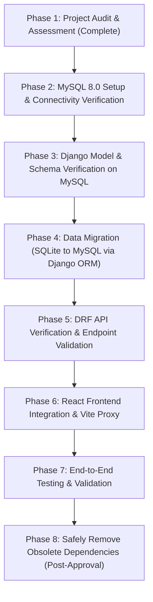

# OyoPasal – Complete Database & Backend Migration Plan
**Document Version:** 1.0.0  
**Phase:** 1 – Project Audit & Migration Assessment  
**Target Architecture:** React 19 + TypeScript (Vite) Frontend | Django REST Framework Backend | MySQL 8.0 InnoDB (utf8mb4)  
**Date:** November 2026  

---

## 1. Executive Summary

This assessment outlines the current state of the OyoPasal multi-vendor marketplace, identifies dual-stack overlaps, audits all database entities across Drizzle/PostgreSQL and Django ORM, and details the safe, phased transition to the final standardized architecture:
- **Frontend:** React 19 + TypeScript + Vite (Port 3000)
- **Backend API:** Python 3.12+ Django 5.x + Django REST Framework (Port 8000)
- **Primary Database:** MySQL Server 8.0 (InnoDB, UTF8MB4, port 3306)
- **ORM / Migrations:** Django ORM with native Django migrations

---

## 2. Complete Repository Audit & Findings

### 2.1 Dual-Stack Codebase Discovery
The project currently contains two co-existing backend implementations:
1. **Legacy Node.js / Express Server:**
   - Entry point: `server.ts`
   - Application logic: `backend/app.ts`, `backend/modules/*.routes.ts`, `backend/services/*.ts`, `backend/middleware/*.ts`
   - Database Layer: Drizzle ORM (`src/db/drizzle.config.ts`, `src/db/schema.ts`, `src/db/index.ts`) targeting PostgreSQL.
   - Seed data: `backend/db/seed.ts` (1,664 lines of seed data for categories, products, vendors, zones).
2. **Modern Django REST Framework Backend:**
   - Entry point: `backend/manage.py`, `backend/config/urls.py`, `backend/config/settings/`
   - Architecture: 26+ modular Django applications in `backend/apps/` (`accounts`, `catalogue`, `vendors`, `customers`, `cart`, `orders`, `payments`, `delivery`, `inventory`, `settlements`, `procurement`, `subscriptions`, etc.).
   - Migrations: 61 applied migrations covering 68 tables.
   - Database status: Currently configured in `backend/.env` with `USE_SQLITE=True` pointing to `backend/db.sqlite3`.

### 2.2 Database Services Audit (Host System)
- **MySQL 8.0:** Windows service `MySQL80` is installed on the system, currently in **`Stopped`** status.
- **PostgreSQL 16:** Windows service `postgresql-x64-16` is **`Running`**. Database inspection revealed:
  - Existing Postgres databases: `['postgres', 'bizora_db', 'kisanbazaar']`.
  - **No `oyopasal` database exists in PostgreSQL**.
- **SQLite (`backend/db.sqlite3`):** Contains **68 tables** and **real operational test data**:
  - `accounts_user`: 14 user accounts (customers, vendors, staff, admin)
  - `vendors_vendorprofile`: 3 vendors
  - `stores_store`: 3 stores
  - `catalogue_product`: 23 active products with variants, images, and prices
  - `catalogue_category`: 4 categories
  - `delivery_deliveryzone`: 7 delivery zones (Kathmandu valley)
  - `inventory_inventoryitem`: 24 inventory items
  - `cart_cart` & `cart_cartitem`: active carts and line items
  - `orders_order`: test orders and status logs

### 2.3 Python Database Drivers Audit
Both required MySQL libraries are already installed in the Python environment:
- `mysqlclient` version **2.2.8** (C-extension, high performance)
- `PyMySQL` version **2.2.8** (Pure Python fallback)
- `psycopg2-binary` version **2.9.12**

### 2.4 Frontend Integration Audit
- **React Frontend:** Communicates exclusively via HTTP REST calls (`src/services/httpClient.ts`).
- **Zero Database Imports in Frontend:** `src/` (excluding `src/db/`) has **no direct database calls**.
- **Proxy Configuration:** `vite.config.ts` currently lacks an explicit proxy for `/api/v1` to `http://127.0.0.1:8000`. In development without `server.ts`, requests to `/api/v1` need to be proxied by Vite or set via `VITE_API_BASE_URL`.

---

## 3. Migration Assessment: Component Categorization

| Category | Components | Actions & Strategy |
| :--- | :--- | :--- |
| **1. Currently Works (Keep & Stabilize)** | - Django REST Framework API (`/api/v1/*`)<br>- JWT Authentication & Token Blacklisting<br>- 68 Django DB Tables & 61 Migrations<br>- React 19 UI & Pages<br>- Health check & Swagger Docs (`/api/docs/`) | Retain 100%. Re-point database connection to MySQL 8.0. |
| **2. Incomplete / Requires Action** | - MySQL 8.0 Service `MySQL80` (currently stopped)<br>- MySQL database `oyopasal_db` and user privileges<br>- Vite reverse-proxy to Django backend (port 8000)<br>- `package.json` `"dev"` script pointing to `server.ts` | Start MySQL service, verify `oyopasal_db`, add Vite proxy, update npm scripts. |
| **3. Needs Migration** | - Active data in `backend/db.sqlite3` (users, products, vendors, zones) | Export via Django `dumpdata`, migrate schema to MySQL, load via `loaddata`. |
| **4. What Should Be Retained** | - All files in `backend/apps/*`<br>- All files in `backend/config/*`<br>- All React components, hooks, contexts, utils | Preserved intact. No business logic removed. |
| **5. Safely Removed Later (Post-Approval)** | - `server.ts`<br>- Express modules in `backend/modules/*.ts`, `backend/services/*.ts`<br>- Drizzle files in `src/db/*`<br>- Unused packages: `drizzle-kit`, `drizzle-orm`, `pg`, `express` | Archive and safely delete ONLY after Phase 7 verification. |

---

## 4. Entity & Model Mapping: Drizzle vs Django ORM

Every single entity defined in the TypeScript Drizzle schema (`src/db/schema.ts`) has a mature, battle-tested counterpart in Django:

| Business Domain | Drizzle Schema (`src/db/schema.ts`) | Django App & Model (`backend/apps/`) | Status |
| :--- | :--- | :--- | :--- |
| **Auth & Users** | `users`, `userSessions`, `adminProfiles` | `apps.accounts.User`, `StaffProfile` | Complete & Migrated |
| **Customers** | `addresses`, `wishlists` | `apps.customers.CustomerProfile`, `Address`, `WishlistItem` | Complete & Migrated |
| **Vendors & Stores**| `vendors`, `sellerProfiles` | `apps.vendors.VendorProfile`, `VendorDocument`, `apps.stores.Store` | Complete & Migrated |
| **Catalog** | `categories`, `products`, `productVariants`, `productImages` | `apps.catalogue.Category`, `Brand`, `Product`, `ProductVariant`, `ProductImage` | Complete & Migrated |
| **Inventory** | `inventoryMovements`, `stockReservations` | `apps.inventory.InventoryItem`, `StockMovement`, `StockReservation` | Complete & Migrated |
| **Cart** | `carts`, `cartItems` | `apps.cart.Cart`, `CartItem` | Complete & Migrated |
| **Orders** | `orders`, `vendorFulfillments`, `orderItems`, `orderStatusHistory` | `apps.orders.Order`, `VendorSubOrder`, `OrderItem`, `OrderStatusHistory` | Complete & Migrated |
| **Payments** | `payments`, `paymentTransactions`, `financialLedger` | `apps.payments.Payment`, `FinancialLedgerEntry` | Complete & Migrated |
| **Delivery** | `deliveryZones`, `deliveryAgents`, `deliveryAssignments` | `apps.delivery.DeliveryZone` | Complete & Migrated |
| **Settlements** | `settlements` | `apps.settlements.VendorSettlement`, `SettlementItem` | Complete & Migrated |
| **Refunds** | `refunds` | `apps.refunds.Refund` | Complete & Migrated |
| **Promotions** | `coupons`, `couponRedemptions`, `promotions`, `advertisements` | `apps.promotions.Coupon`, `CouponUsage`, `MarketingPromotion`, `Advertisement` | Complete & Migrated |
| **Reviews** | `reviews` | `apps.reviews.ProductReview` | Complete & Migrated |
| **Support** | `supportTickets`, `ticketMessages` | `apps.support.SupportTicket`, `TicketMessage` | Complete & Migrated |
| **Audit** | `auditLogs` | `apps.audit.AuditLog` | Complete & Migrated |
| **Subscriptions**| *(Not present in Drizzle)* | `apps.subscriptions.SubscriptionPlan`, `TenantSubscription`, `SubscriptionInvoice` | Extended in Django |
| **Suppliers** | *(Not present in Drizzle)* | `apps.suppliers.SupplierProfile`, `apps.procurement.*` | Extended in Django |

---

## 5. Detailed Phased Implementation Workflow



### Phase 2: MySQL Authentication and Database Configuration
1. User starts MySQL 8.0 service via PowerShell (`Start-Service -Name MySQL80` or `net start MySQL80`).
2. Run database initialization script to ensure `oyopasal_db` exists with `utf8mb4` encoding:
   ```sql
   CREATE DATABASE IF NOT EXISTS oyopasal_db CHARACTER SET utf8mb4 COLLATE utf8mb4_unicode_ci;
   CREATE USER IF NOT EXISTS 'oyopasal_user'@'localhost' IDENTIFIED BY 'oyopasal_password';
   GRANT ALL PRIVILEGES ON oyopasal_db.* TO 'oyopasal_user'@'localhost';
   FLUSH PRIVILEGES;
   ```
3. Update `backend/.env`:
   ```ini
   USE_SQLITE=False
   DB_ENGINE=django.db.backends.mysql
   DB_NAME=oyopasal_db
   DB_USER=oyopasal_user
   DB_PASSWORD=oyopasal_password
   DB_HOST=127.0.0.1
   DB_PORT=3306
   ```
4. Verify Django DB connectivity with `python manage.py check --database default`.

### Phase 3: Django Model & Schema Verification
1. Apply all Django migrations to MySQL:
   ```powershell
   python manage.py migrate
   ```
2. Verify all 68 tables are created in MySQL with InnoDB engine and proper foreign keys/indexes.

### Phase 4: Data Migration (Zero Data Loss)
1. Dump current application records from SQLite using Django's UTF-8 JSON serializer:
   ```powershell
   python manage.py dumpdata --natural-foreign --natural-primary -e contenttypes -e auth.Permission --indent 2 -o database/backups/sqlite_export.json
   ```
2. Switch to MySQL and load records cleanly:
   ```powershell
   python manage.py loaddata database/backups/sqlite_export.json
   ```
3. Verify row counts matching SQLite (14 users, 23 products, 3 vendors, 7 delivery zones).

### Phase 5: Django REST API Validation
1. Verify API root `GET /` and health check `GET /api/v1/health/`.
2. Test user authentication: `POST /api/v1/auth/login/`, token refresh, registration.
3. Test vendor portal endpoints: `POST /api/v1/auth/seller/login/`, `GET /api/v1/seller/dashboard/`.
4. Test product catalog: `GET /api/v1/products/`, categories, variants, inventory.
5. Test cart, checkout, orders, and payment endpoints.

### Phase 6: React Frontend Integration
1. Update `vite.config.ts` to add proxy:
   ```typescript
   server: {
     proxy: {
       '/api': {
         target: 'http://127.0.0.1:8000',
         changeOrigin: true,
       },
     },
   }
   ```
2. Update `package.json` scripts:
   - `"dev": "vite --port 3000 --host 127.0.0.1"`
   - Remove dependency on `tsx server.ts`.
3. Verify frontend pages (Home, Category, Product Detail, Cart, Checkout, Seller Portal, Customer Profile) against live Django API.

### Phase 7: End-to-End Testing & Validation
1. Run automated backend test suite (`pytest` / `python manage.py test`).
2. Run frontend TypeScript linting (`npm run lint`).
3. Verify database persistence by restarting Django and querying MySQL directly.

### Phase 8: Safe Removal of Obsolete Code (Upon Explicit User Approval)
- Create a backup archive of legacy Node files before removal.
- Remove `server.ts`, `backend/app.ts`, `backend/modules/`, `backend/services/`, `backend/middleware/`, `src/db/`.
- Clean `package.json` dependencies (`drizzle-kit`, `drizzle-orm`, `pg`, `express`).
